<p align="center">
  
</p>

<p align="center">
  <a href="https://github.com/johnbarraza/ai-job-search-peru/releases/latest/download/ai-job-search-peru.zip"></a>
  <a href="https://github.com/johnbarraza/ai-job-search-peru/releases/latest"></a>
  <a href="https://github.com/johnbarraza/ai-job-search-peru/releases/latest"></a>
</p>

# AI Job Search · Edición Perú

Herramientas para buscar ofertas en portales peruanos, revisar requisitos, preparar un CV por puesto y llevar el estado de cada postulación. Es una adaptación para Perú de [AI Job Search](https://github.com/ai-job-search-dev/ai-job-search), iniciado por Mads Lorentzen (Dinamarca).

**La búsqueda puede funciona sin IA (limitado).** Buscar, cruzar portales, fechar, armar la página de revisión y programar la búsqueda diaria no necesitan ningún modelo. Un agente (Claude Code, Codex o Antigravity) es opcional y suma tres cosas: evaluar el encaje con tu perfil (`/rank`), adaptar el CV y la carta (`/apply`) y preparar entrevistas (`/interview`).

<p align="center">
  
</p>

## Contenido

- [Inicio rápido](#inicio-rápido): [forma 1, con dos scripts](#forma-1-con-dos-scripts-recomendada) · [forma 2, paso a paso](#forma-2-paso-a-paso-a-mano) · [forma 3, con un agente de IA](#forma-3-con-un-agente-de-ia)
- [El flujo, paso a paso](#el-flujo-paso-a-paso)
- [Comandos](#comandos)
- [Cómo funciona `/apply`](#cómo-funciona-apply)
- [Con otro agente: Codex y Antigravity](#con-otro-agente-codex-y-antigravity)
- [Portales](#portales)
- [Personalización](#personalización)
- [Privacidad y seguridad](#privacidad-y-seguridad)
- [Estructura de archivos](#estructura-de-archivos)
- [Guías](#guías)

## Inicio rápido

Hay tres formas de instalarlo y empezar, con el mismo resultado:

- **Forma 1, con dos scripts (recomendada):** instalan lo que falta, crean tu perfil y hacen la primera búsqueda, preguntándote lo necesario.
- **Forma 2, paso a paso:** los mismos pasos, comando por comando, para ver o controlar cada uno.
- **Forma 3, con un agente de IA:** le pegas un prompt a Claude Code, `agy` o Codex y él hace los pasos, te pregunta lo necesario y te explica cualquier error.

¿Primera vez con Python o con una terminal? [docs/INSTALAR.md](docs/INSTALAR.md) explica cada paso desde cero, para Windows y Mac.

### Forma 1: con dos scripts (recomendada)

Necesitas **Git** instalado ([cómo](#qué-necesitas)) y, si vas a usar IA, **Claude Code o `agy` ya instalado y con sesión iniciada** ([docs/AGENTES_IA.md](docs/AGENTES_IA.md)). Lo demás lo hacen los scripts.

1. **Descarga** el proyecto (`git clone`, o el [ZIP](https://github.com/johnbarraza/ai-job-search-peru/releases/latest/download/ai-job-search-peru.zip) descomprimido).
2. **Corre `instalar_full.sh`**: doble clic en el archivo (Windows) o, en la carpeta del proyecto, clic derecho → *Open Git Bash here* y `bash instalar_full.sh` (Mac/Linux: en la terminal). No como administrador.
3. **Responde lo que pregunta.** Al terminar de instalar ofrece seguir con `empezar.sh` (Enter = sí), que hace el resto:

| Paso | Qué hace | Qué te pide | Cuánto tarda |
|---|---|---|---|
| `instalar_full.sh` 1/5 a 4/5 | Revisa el sistema e instala lo que falte: Python, Bun, LaTeX | Permiso de Windows (ventana) o tu contraseña en Mac, si hace falta | 5 a 30 min la primera vez (LaTeX es lo más pesado); segundos si ya estaba |
| `instalar_full.sh` 5/5 | `.venv`, librerías y buscadores de portales (`instalar_basico.sh`) | Nada | 1 a 3 min |
| `empezar.sh` 1/5 | Crea tu perfil en `perfiles/<tu-nombre>/` | Tu nombre | Segundos |
| `empezar.sh` 2/5 | Si tienes Claude Code, lo abre con `/setup`: tu CV, tus datos, qué buscas | Responder a Claude; al terminar, `/exit` y el script sigue | 10 a 20 min |
| `empezar.sh` 3/5 | Arma tus búsquedas (`consultas.json`) y completa tu nivel, modalidad y lugar en el perfil | Con opciones numeradas: sector (privado, público, investigación, otros), modalidad, dónde (Lima, otra ciudad, también fuera), tu etapa (estudiante, egresado, ya trabajo); y los puestos que buscas | 1 min |
| `empezar.sh` 4/5 | Primera búsqueda en todos los portales y la página de revisión, que se abre sola | Nada | 5 a 15 min |
| `empezar.sh` 5/5 | Programa la búsqueda diaria; opcional: que Claude evalúe las nuevas cada día | La hora (Enter = no programar) | Segundos |

**Si se detiene o lo cierras:** vuelve a correr el mismo script. Cada uno salta lo que ya quedó hecho (programas instalados, perfil creado, búsquedas definidas), así que no pierdes nada.

| Pasó esto | Haz esto |
|---|---|
| Dice `ERROR en el paso N`, con el motivo arriba | Corrige lo que dice (por ejemplo, internet o permiso) y vuelve a correr el mismo script. El detalle queda en `instalar.log` |
| «Bun aún no aparece» o «LaTeX aún no aparece» | Recién instalados: cierra la ventana, abre otra y corre de nuevo `bash instalar_full.sh` |
| Cerraste la ventana durante la instalación | `bash instalar_full.sh` |
| Ya instaló, pero no seguiste (o cerraste) en `empezar.sh` | `bash empezar.sh` |
| La primera búsqueda se cortó o un portal falló | En `perfiles/<tu-nombre>`: `python tools/pe_pipeline.py diario` (retoma lo que faltó ese día) |
| La PC estaba apagada a la hora de la búsqueda diaria | Nada: corre sola al iniciar sesión |
| Quieres cambiar qué buscas | Edita `perfiles/<tu-nombre>/reports/busqueda/consultas.json`, o en el perfil: `python tools/pe_pipeline.py consultas --q "..." --reemplazar` |
| Quieres cambiar la hora de la búsqueda diaria | En el perfil: `python tools/pe_pipeline.py programar --hora "7:00 am"` (`--quitar` la elimina) |

**Después, cada día:** abre `perfiles/<tu-nombre>/reports/revision-ofertas.html`. Si arriba aparece el recuadro naranja de **nuevas sin evaluar**, su botón copia el comando que las pasa por `/rank` con Claude o `agy`. En cada oferta: **Guardar**, **Hacer CV** (te copia el pedido para el agente) o **Descartar**.

### Forma 2: paso a paso, a mano

Hace lo mismo que la forma 1, comando por comando. Lo que necesitas instalar vale para las dos formas.

#### Qué necesitas

| Programa | Para qué | ¿Obligatorio? |
|---|---|---|
| **Git** | Descargar el proyecto y sus actualizaciones | Sí |
| **Python 3.10+** | Búsqueda, página de revisión, sueldos, perfiles | Sí |
| **[Bun](https://bun.sh)** | Buscadores de LinkedIn, Bumeran, Computrabajo y Get on Board | Sí, para esos portales |
| **LaTeX** con `lualatex` y `xelatex` ([MiKTeX](https://miktex.org/), [TeX Live](https://tug.org/texlive/), [MacTeX](https://tug.org/mactex/)) | Compilar CV y cartas a PDF | Solo si generas CV |
| **Google Chrome** | Bolsa UP (inicias sesión tú) | Solo para la Bolsa UP |
| **Un agente:** Claude Code, Codex o Antigravity CLI ([cómo instalarlos](docs/AGENTES_IA.md)) | `/setup`, `/rank`, `/apply`, `/interview` | No. Cada uno pide su propia cuenta o plan |

**Instalar Git:** Windows `winget install --id Git.Git -e` (o el instalador de [git-scm.com](https://git-scm.com/)) · Mac `xcode-select --install` · Linux `sudo apt install git`. Cierra y abre la terminal, y comprueba con `git --version`. Git hace falta también con el ZIP: los perfiles, el hook de privacidad y `git pull` dependen de él.

<details>
<summary>Letra pequeña: otros agentes, motores LaTeX y extracción de texto del PDF</summary>

- **Otros agentes.** Codex y Antigravity leen [AGENTS.md](AGENTS.md) y las skills de portales en `.agents/skills/`. Los comandos `/rank` y `/apply` están escritos para Claude Code; a otro agente se le pide que siga el archivo correspondiente de `.claude/commands/`. Ver [Con otro agente](#con-otro-agente-codex-y-antigravity).
- **Motores LaTeX.** El CV compila con `lualatex`, porque `pdflatex` suele fallar en MiKTeX reciente con errores de `fontawesome5`. La carta compila con `xelatex`, porque `cover.cls` usa `fontspec`. Con TinyTeX o BasicTeX instala los paquetes extra de [SETUP.md](SETUP.md#minimal-tex-install-tinytexbasictex).
- **Texto del PDF (ATS).** `pypdf` viene en `requirements.txt` (licencia BSD, no necesita Poppler). `pdftotext` de Poppler es el respaldo. Si faltan ambos, la revisión ATS se hace leyendo el PDF.

</details>

#### 1. Descargar

Para tu propia búsqueda, **clona** el repositorio:

```powershell
git clone --recurse-submodules https://github.com/johnbarraza/ai-job-search-peru.git
cd ai-job-search-peru
```

**O baja el ZIP** de la [última versión](https://github.com/johnbarraza/ai-job-search-peru/releases/latest) (`ai-job-search-peru.zip`) y descomprímelo. Es un clon completo: trae `vendor/jev-browse` y la carpeta `.git`, así que funciona igual que `git clone` y se actualiza con `git pull`. No uses el "Source code (zip)" que GitHub agrega solo: no trae ninguna de las dos.

> [!IMPORTANT]
> **Un fork de este repositorio siempre es público**: GitHub no permite forks privados de repositorios públicos. Tus datos personales (nombre, contacto, historial, sueldo esperado, CV) viven en `perfiles/<nombre>/`. Esa carpeta está ignorada por Git y es un *worktree* en la rama local `perfil/<nombre>`. Un hook `pre-push` impide que esa rama llegue a un remoto, y `tools/privacy_guard.py` revisa los demás pushes. Aun así:
> - **Para buscar trabajo:** clona, o usa un **repositorio privado** con este como `upstream` ([SETUP.md, sección 8](SETUP.md#8-pulling-upstream-updates-into-your-fork)).
> - **Haz fork solo para contribuir:** `gh repo fork johnbarraza/ai-job-search-peru --clone` y luego `gh repo set-default <tu-usuario>/ai-job-search-peru`. Sin esa segunda línea, `gh issue create` publica en el repositorio original ([SETUP.md, sección 2](SETUP.md#2-fork-and-clone)).

#### 2. Instalar

Desde la carpeta del proyecto:

```powershell
python -m venv .venv
.venv\Scripts\Activate.ps1                # Mac/Linux: source .venv/bin/activate
python -m pip install -r requirements.txt
python tools/install_portal_clis.py
```

**O, en un solo paso (recomendado),** desde Git Bash (Windows: clic derecho en la carpeta → *Open Git Bash here*) o la terminal (Mac/Linux):

```bash
bash instalar_full.sh
```

- **`instalar_full.sh`** instala lo que falte de Python, Bun y LaTeX (con `winget` en Windows, Homebrew en Mac, `apt` en Linux) y luego corre el básico. LaTeX ocupa varios GB; en Mac pide tu contraseña.
- **Ábrelo como usuario normal, no como administrador.** Instala para tu usuario; si un programa necesita permiso, Windows lo pide en una ventana. Muestra el avance (`[###--] paso 3 de 5`) y guarda todo en `instalar.log`.
- **Si falla**, dice en qué paso y por qué. Corrige eso y vuelve a correrlo: salta lo que ya quedó instalado.
- **Al terminar sigue solo** con `empezar.sh` (o córrelo tú después: `bash empezar.sh`): te pide tu nombre y crea tu perfil, abre Claude Code con `/setup` si lo tienes, pregunta qué puestos buscas y en qué ciudad, hace la primera búsqueda, abre la página y te ofrece programar la búsqueda diaria.
- **¿Doble clic?** En Windows, Git suele asociar los `.sh` a Git Bash: doble clic en `instalar_full.sh` funciona y la ventana espera un Enter antes de cerrarse. Si se abre con otro programa, usa clic derecho en la carpeta → *Open Git Bash here* y escribe el comando.
- **`instalar_basico.sh`** solo crea `.venv`, instala las librerías con versión fija y los buscadores. Úsalo si ya tienes los programas, o después de un `git pull`.

Ambos se pueden repetir sin riesgo.

<details>
<summary>Qué hace <code>install_portal_clis.py</code></summary>

Corre `bun install --ignore-scripts` en cada CLI de `.agents/skills/*/cli/`. Las descubre en la carpeta, así que incluye las que agregues con `/add-portal`. Una CLI que declare scripts de instalación se salta y se informa, en vez de ejecutarse. `--dry-run` muestra qué instalaría.

</details>

#### 3. Crear tu perfil

Cada persona tiene su carpeta `perfiles/<nombre>/`, con su CV, sus consultas y sus resultados.

**Con Claude Code**, desde la raíz del proyecto:

```text
claude
/setup --user <nombre>
```

`/setup` ofrece tres caminos:

- leer tu carpeta `documents/` (CV, exportación de LinkedIn, constancias, postulaciones anteriores);
- importar un solo CV;
- hacerte una entrevista por secciones.

Llena el perfil, las preferencias (nivel, modalidad, distritos) y las consultas de búsqueda. Desde entonces, **abre el agente dentro de `perfiles/<nombre>/`**.

**Sin IA:**

```powershell
python tools/perfiles.py crear <nombre> --cv "C:\ruta\a\mi_cv.pdf"
```

Luego completa a mano `perfiles/<nombre>/CLAUDE.md` y `perfiles/<nombre>/reports/busqueda/consultas.json`. Ver [Qué archivos editar a mano](#qué-archivos-editar-a-mano).

#### 4. Buscar

```powershell
cd perfiles\<nombre>
python tools/pe_pipeline.py buscar --detalle --registrar
python tools/pe_pipeline.py actualizar --titulo "Tu Nombre"
python tools/pe_pipeline.py estado
```

Abre `reports\revision-ofertas.html` con doble clic. Funciona sin internet y muestra:

- las ofertas nuevas, con fecha, cierre, lugar, modalidad y sueldo cuando el aviso lo publica;
- la frescura de cada vacante y si está duplicada en varios portales;
- la cobertura de cada portal;
- con un agente, además el encaje con tu perfil y el botón **CV sugerido**.

#### 5. Dejarlo automático (opcional)

```powershell
python tools/pe_pipeline.py programar --hora "8:00 am"
```

Desde ese día, la búsqueda y la página se actualizan solas a esa hora: Programador de tareas en Windows, `launchd` en Mac. La hora la eliges tú y es de Perú (UTC-5): acepta `8:00 am`, `7:30 p. m.` o `20:30`; `--utc` la lee en UTC. Para cambiarla, vuelve a correr `programar`. Si la PC estaba apagada a esa hora o la corrida se cortó, se retoma desde el paso pendiente al iniciar sesión. Con `--ia agy` o `--ia claude`, también corre `/rank` después de buscar. Cada corrida queda en `reports/busqueda/diario.log`, con fecha DD/MM/AAAA. Detalles en [docs/PIPELINE.md](docs/PIPELINE.md#diario-y-programar-la-búsqueda-todos-los-días-sola).

#### 6. Evaluar y postular (con un agente)

Dentro de `perfiles/<nombre>/`:

```text
/rank                                      # puntúa hasta 10 ofertas nuevas contra tu perfil
/apply https://pe.computrabajo.com/...     # evalúa una oferta y prepara CV y carta
/apply <pega aquí el texto del aviso>      # si el portal no deja leer el enlace
python tools/pe_pipeline.py actualizar     # la página muestra el encaje y el CV sugerido
```

**Tú revisas el PDF final y decides si se envía.** Ningún comando postula por su cuenta. El envío por la Bolsa UP es un comando aparte que exige `--confirm`.

### Forma 3: con un agente de IA

Necesitas **Git** y un agente **instalado y con sesión iniciada**: Claude Code, Antigravity CLI (`agy`) o Codex ([docs/AGENTES_IA.md](docs/AGENTES_IA.md)). Descarga el proyecto (paso 1 de la forma 2), abre una terminal **en la carpeta del proyecto**, inicia el agente (`claude`, `agy` o `codex`) y pégale esto:

```text
Ayúdame a dejar listo este proyecto (AI Job Search · Edición Perú) en esta PC y a correr mi primera búsqueda.
Sigue el README (formas 1 y 2) y docs/INSTALAR.md, en este orden, y avísame antes de empezar cada paso:

1. Revisa qué tengo: git, Python 3.10 o más nuevo, Bun y LaTeX (lualatex). Si falta alguno, dime el
   comando para instalarlo y espera mi OK: no instales programas del sistema sin preguntarme.
2. Instala el proyecto con: bash instalar_basico.sh
   (crea .venv, las librerías con versión fija y los buscadores). Si falla, explícame el error y cómo seguir.
3. Pregúntame mi nombre (una palabra) y crea mi perfil: python tools/perfiles.py crear <nombre>
   Desde ahí, todo lo de la búsqueda se corre dentro de perfiles/<nombre>/.
4. Arma mi perfil: si eres Claude Code, corre /setup --user <nombre>; si no, sigue .claude/commands/setup.md.
   Pídeme mi CV y lo que busco; no inventes datos.
5. Pregúntame, con opciones numeradas: sector (privado, público, investigación, otros; puedo elegir varios),
   modalidad (remoto, presencial, híbrido, cualquiera), dónde (Lima, otra ciudad del Perú, también fuera solo
   remoto, también fuera mudándome), mi etapa (estudiante, egresado, ya trabajo) y qué puestos busco.
   Con eso crea mis búsquedas en el perfil:
   python tools/pe_pipeline.py consultas --q "<puestos>" --sector "<privado,publico,investigacion,otros>"
     --modalidad "<remoto|presencial|hibrido|cualquiera>" --lugar "<lima|peru|afuera-remoto|afuera>"
     --ciudad "<ciudad>" --etapa "<estudiante|egresado|profesional>"
6. Corre la primera búsqueda en el perfil: python tools/pe_pipeline.py diario
   Tarda de 5 a 15 minutos. Si un portal falla, sigue con los demás y dime cuál.
7. Evalúa las ofertas nuevas: /rank en Claude Code, o siguiendo .claude/commands/rank.md. Después corre
   python tools/pe_pipeline.py actualizar y ábreme reports/revision-ofertas.html.
8. Pregúntame si quiero que busque sola todos los días y a qué hora (hora de Perú). Si digo que sí:
   python tools/pe_pipeline.py programar --hora "<hora>"

Reglas: usa siempre el Python de .venv; no agregues paquetes ni cambies versiones; no hagas git push ni subas
nada; no postules ni envíes nada a ninguna empresa; no borres reports/busqueda/linkedin-control.json.
Al terminar, dime qué quedó listo, qué comandos corriste y qué falló, con el mensaje de error exacto.
```

**Si se corta** (cierras el agente, se acaba la sesión, falla un paso): vuelve a abrirlo en la misma carpeta y pídele «sigue con el prompt de la forma 3 del README desde donde quedamos». Cada paso salta lo que ya está hecho, igual que en la forma 1.

## El flujo, paso a paso

| Paso | Comando | Necesita IA | Qué escribe |
|---|---|---|---|
| 1. Buscar | `pe_pipeline.py buscar --detalle --registrar` | No | `reports/busqueda/<fecha>_<hora>/`, `nuevas.json`, `cobertura.json`, `reports/detalles/*.json`; marca las nuevas como `new` en `job_scraper/seen_jobs.json` |
| 2. Evaluar | `/rank` | Sí | Puntaje, veredicto, fortalezas y brechas en `seen_jobs.json` |
| 3. Armar la página | `pe_pipeline.py actualizar` | No | Duplicados, frescura, lugar y rubro → `reports/revision-ofertas.html` y `.json` |
| 4. Decidir | `pe_pipeline.py estado` | No | En pantalla: qué cierra en 7 días y qué postular primero |
| 5. Postular | `/apply <url>` | Sí | `cv/main_<empresa>_<puesto>.tex` y `.pdf`, `cover_letters/cover_<empresa>_<puesto>.tex` y `.pdf` |
| 6. Seguimiento | `/outcome`, `/interview` | Sí | Estado en `job_search_tracker.csv`, archivo de lo enviado, preparación de entrevista |

`pe_pipeline.py diario` encadena los pasos 1, 2 (opcional, con `--ia`) y 3. `programar` lo corre cada día.

Cada paso deja un archivo, así que cualquier agente continúa donde quedó el anterior sin repetir la búsqueda. Por ejemplo: «lee `reports/revision-ofertas.json` y dime qué hago hoy».

## Comandos

### Sin IA (terminal)

Todos se corren desde la carpeta del perfil, con el entorno activo.

| Comando | Qué hace |
|---|---|
| `python tools/pe_pipeline.py buscar [--detalle] [--registrar] [--portal X]` | Corre las consultas de `consultas.json` en cada portal y guarda solo las ofertas nuevas |
| `python tools/pe_pipeline.py actualizar [--titulo "Nombre"] [--logos]` | Duplicados, frescura, lugar y rubro, y la página de revisión |
| `python tools/pe_pipeline.py estado [--json]` | Qué cierra pronto y qué postular |
| `python tools/pe_pipeline.py portales [--json]` | Cobertura de la última corrida y enlaces para los portales sin CLI |
| `python tools/pe_pipeline.py diario [--ia agy\|claude]` | Buscar → `/rank` opcional → actualizar, con registro en `diario.log` |
| `python tools/pe_pipeline.py programar --hora "8:00 am" [--utc] [--ia agy]` | Deja `diario` como tarea diaria; `--quitar` la elimina |
| `python tools/perfiles.py crear\|lista\|ruta\|actualizar\|borrar` | Perfiles: crear, listar, traer mejoras, borrar (`borrar` pide `--si`) |
| `python tools/pe_sueldo.py 2500 --regimen general --pension onp` | Cuánto vale una oferta al año y en mano (planilla, RxH, prácticas); `--comparar` muestra los regímenes lado a lado |
| `python tools/myworkin_salaries.py "Empresa"` | Sueldos reportados de una empresa en MyWorkIn |
| `python tools/pe_servir.py`, `python tools/pe_practicas.py` | Búsqueda y ficha en Talento Perú (SERVIR) y Prácticas.pe |

Todas las opciones, con ejemplos, están en [docs/PIPELINE.md](docs/PIPELINE.md).

### Con un agente

`/setup`, `/rank` y `/apply` son el flujo principal. Los demás lo completan cuando ya tienes perfil.

| Comando | Qué hace |
|---|---|
| **`/setup`** | Arma tu perfil a partir de documentos, un CV o una entrevista (`--user <nombre>` crea el perfil, `--section search` rehace solo las consultas) |
| **`/rank`** | Puntúa las ofertas nuevas contra tu perfil y devuelve una lista corta con fortalezas y brechas |
| **`/apply`** | Evalúa una oferta y redacta, revisa y compila el CV y la carta |
| `/scrape` | Búsqueda dirigida por el agente; la alternativa sin IA es `pe_pipeline.py buscar` |
| `/interview` | Preparación para una entrevista concreta y simulacro |
| `/outcome` | Registra resultados, archiva lo enviado y redacta seguimientos |
| `/upskill` | Brechas de habilidades frente a las ofertas y plan de estudio |
| `/expand` | Agrega competencias de tus perfiles públicos y sílabos |
| `/html-report` | Panel sin conexión de tus postulaciones |
| `/gmail-sync`, `/notion-sync` | Estado desde Gmail; vista de solo lectura en Notion |
| `/add-template` | Registra tu propia plantilla de CV o carta |
| `/add-portal` | Genera un buscador para otro portal |
| `/reset` | Borra datos del perfil o documentos (pide escribir `RESET`) |

## Cómo funciona `/apply`

1. **Lee la oferta**, desde el enlace o el texto pegado. Antes pasa un filtro de integridad: texto oculto, caracteres invisibles, líneas con forma de instrucción.
2. **Evalúa el encaje**: habilidades, experiencia, cultura, lugar y modalidad, nivel del puesto. Para avisos peruanos aplica también [10-peru-market.md](.claude/skills/job-application-assistant/10-peru-market.md): régimen del contrato detrás del sueldo, ley de prácticas, requisitos del sector público y filtros de tercio o quinto superior.
3. **Redacta** el CV (`moderncv`, estilo banking, **1 página** por defecto) y la carta (`cover.cls`).
4. **Un segundo agente revisa**: investiga la empresa y critica los borradores.
5. **Corrige** según esa revisión.
6. **Compila y mira los PDF**: `lualatex` para el CV y `xelatex` para la carta. Itera hasta que el CV tenga el largo de tu perfil y la carta quepa en una página con la firma.
7. **Revisión ATS**: extrae el texto del PDF como lo vería un sistema de selección (correo y teléfono como texto, orden de lectura, palabras clave del aviso). Las brechas reales quedan a la vista; no se rellenan.
8. **Presenta** el resultado con la lista de verificación.

Todo dato del CV y la carta sale de tu perfil; no se inventan habilidades ni experiencia.

> [!WARNING]
> Los avisos son texto ajeno: el flujo no sigue instrucciones escritas en ellos ni abre sus enlaces. Esas defensas son instrucciones al modelo, no un sandbox. Revisa lo que se leyó y se escribió antes de enviar. Ver [SECURITY.md](SECURITY.md).

## Con otro agente: Codex y Antigravity

| Qué | Claude Code | Codex / Antigravity |
|---|---|---|
| Búsqueda y página (`pe_pipeline.py`) | Sí | Sí: es Python, no depende del agente |
| Skills de portales (`.agents/skills/`) | Sí | Sí, las detectan solos |
| Instrucciones del proyecto | `CLAUDE.md` | `AGENTS.md`, que apunta a las mismas reglas de `.claude/` |
| `/rank`, `/apply`, `/interview` | Comandos `/…` | Pídele «sigue `.claude/commands/apply.md` con esta oferta: …» |
| `/rank` automático cada día | `programar --ia claude` | `programar --ia agy` (Antigravity) |

**Antigravity CLI (`agy`).** Inicia sesión una vez con `agy` en modo interactivo. Después `diario --ia agy` corre `/rank` sin ventana (`agy -p … --output-format json`). No se aprueba ninguna herramienta automáticamente: agy usa tus reglas de `~/.gemini/antigravity-cli/settings.json`, y lo que no permitas lo salta y lo deja anotado en el registro. Las reglas mínimas para `/rank` están en [docs/PIPELINE.md](docs/PIPELINE.md#diario-y-programar-la-búsqueda-todos-los-días-sola).

## Portales

| Fuente | Acceso en este proyecto |
|---|---|
| LinkedIn, Bumeran, Computrabajo, Get on Board | CLI de búsqueda pública en `.agents/skills/` |
| Talento Perú / SERVIR, Prácticas.pe | CLI local, integrado en el pipeline |
| Bolsa UP / Symplicity | CLI optativo con Chrome y tu sesión: búsqueda, fichas, «Solicitudes» y formulario interno |
| Laborum, Empleos Perú, Indeed, Glassdoor | Enlaces de búsqueda manual o herramientas optativas |

- **LinkedIn** se consulta como máximo una vez cada 20 horas, con pausas entre pedidos. Ante un `429` espera 48 horas; los demás portales siguen.
- **Bolsa UP:** configura `symplicity_account` y una consulta `bolsa-universidad`, e inicia sesión tú en Chrome. Subir un CV y enviar una solicitud son comandos aparte con `--confirm`. Ver [docs/SYMPLICITY.md](docs/SYMPLICITY.md).

Qué portales corrieron en la última búsqueda: `python tools/pe_pipeline.py portales`. Detalle, errores y límites: [docs/PORTALES.md](docs/PORTALES.md).

## Personalización

### Qué archivos editar a mano

Si prefieres no usar `/setup`, edita estos archivos dentro de `perfiles/<nombre>/`:

| Archivo | Qué cambiar |
|---|---|
| `CLAUDE.md` | Perfil completo: nombre, idiomas, nivel buscado, modalidad, `Abroad`, formación, experiencia, habilidades, deal-breakers |
| `.claude/skills/job-application-assistant/01-candidate-profile.md` | Tu CV en forma estructurada |
| `.claude/skills/job-application-assistant/02-behavioral-profile.md` | Perfil conductual o autoevaluación |
| `.claude/skills/job-application-assistant/04-job-evaluation.md` | Áreas de encaje, metas, filtros de motivación |
| `.claude/skills/job-application-assistant/05-cv-templates.md` | Frases de perfil para cada tipo de puesto |
| `.claude/skills/job-application-assistant/07-interview-prep.md` | Tus ejemplos STAR reales |
| `reports/busqueda/consultas.json` | Qué buscar, dónde y en qué portal ([formato](docs/PIPELINE.md#consultasjson)) |
| `cv/main_example.tex` | Tu CV base en LaTeX |

### Cambiar las consultas

Con el agente, `/setup --section search` rehace solo la parte de búsqueda y sugiere puestos que quizá no consideraste. A mano, edita `consultas.json`:

```json
{
 "jobage": 14,
 "excluir_titulo": ["senior", "jefe", "gerente"],
 "consultas": [
  {"portal": "linkedin", "q": "practicante finanzas", "l": "Lima, Peru"},
  {"portal": "computrabajo", "q": "practicante de riesgos", "l": "Lima"},
  {"portal": "talento-peru", "q": "economia", "l": "Lima", "tipo": "laboral"},
  {"portal": "practicas-pe", "q": "economia", "l": "Lima"}
 ]
}
```

### Plantillas propias

El CV usa [moderncv](https://ctan.org/pkg/moderncv) (estilo banking) y la carta, `cover.cls` con Lato y Raleway; ambas son LaTeX. Para usar tu propia plantilla (LaTeX, [Typst](https://typst.app/) o cualquier herramienta que compile a PDF desde la terminal):

```text
/add-template                  # registra la plantilla, la compila de prueba y la activa para /apply
/add-template --list           # plantillas registradas
/add-template --use <nombre>   # cambiar de plantilla
/add-template --use default    # volver a moderncv / cover.cls
```

Compilar a mano las plantillas de serie:

```powershell
Set-Location cv; lualatex main_<empresa>_<puesto>.tex; Set-Location ..
Set-Location cover_letters; xelatex cover_<empresa>_<puesto>.tex; Set-Location ..
```

### Otros portales

`/add-portal` investiga un portal (URL de búsqueda, estructura, `robots.txt`), genera su CLI con el mismo contrato que las demás y la prueba con una consulta real. Rechaza los portales que exigen iniciar sesión. Ver [docs/PORTALES.md](docs/PORTALES.md).

### Sueldos

`pe_sueldo.py` convierte una oferta mensual en anual y en neto: gratificaciones, CTS, ONP o AFP, quinta categoría, recibo por honorarios y subvención de prácticas. `myworkin_salaries.py` agrega sueldos reportados por empresa, y `/apply` los usa cuando existen.

### Empezar de nuevo

```text
/reset profile      # borra tus datos de las skills; conserva las reglas
/reset documents    # borra los archivos de documents/
/reset all          # ambos
```

O borra el perfil entero: `python tools/perfiles.py borrar <nombre> --si`.

### Actualizar

Desde la carpeta principal del proyecto:

```powershell
git pull
python -m pip install -r requirements.txt
python tools/install_portal_clis.py
python tools/perfiles.py actualizar --todos
```

La última línea pasa las mejoras a cada perfil sin tocar tus datos. Para ver qué cambió en el proyecto original: `python tools/check_upstream_updates.py` y `python tools/upstream_triage.py --remote upstream` ([SETUP.md, sección 8](SETUP.md#8-pulling-upstream-updates-into-your-fork)).

## Privacidad y seguridad

- **Datos personales.** CV, historial, consultas y resultados viven en `perfiles/<nombre>/`, ignorada por Git. Su rama `perfil/<nombre>` no se puede subir a un remoto (hook `pre-push`), y `tools/privacy_guard.py` frena cualquier push que lleve tu nombre, correo, teléfono o LinkedIn.
- **Sesiones.** La Bolsa UP guarda la sesión fuera del repositorio (`%LOCALAPPDATA%`, cifrada para tu cuenta de Windows) y nunca recibe contraseñas como argumento.
- **Postulaciones.** Ningún agente ni tarea programada postula por ti. El **CV sugerido** de la página es un PDF ya preparado; pulsarlo no genera nada nuevo.
- **IA sin supervisión.** `diario --ia` no usa `--dangerously-skip-permissions` ni amplía permisos. Revisa `git status` en el perfil tras las primeras corridas.

## Estructura de archivos

```text
ai-job-search-peru/
├── tools/                 # pe_pipeline.py y las herramientas sin IA (Python)
├── .agents/skills/        # buscadores de portales (Bun / TypeScript)
├── .claude/
│   ├── commands/          # /setup, /rank, /apply, /interview… (fuente canónica)
│   ├── skills/            # metodología: perfil, evaluación, CV, mercado peruano
│   └── agents/            # revisor de postulaciones, lector y puntuador de avisos
├── cv/, cover_letters/    # plantillas LaTeX
├── docs/                  # INSTALAR, PIPELINE, PORTALES, SYMPLICITY
├── perfiles/<nombre>/     # tu espacio (ignorado por Git)
│   ├── CLAUDE.md          # tu perfil
│   ├── reports/           # búsquedas, detalles, página de revisión, diario.log
│   └── job_scraper/       # seen_jobs.json: estado de cada oferta
├── AGENTS.md              # instrucciones para Codex, Antigravity y otros agentes
└── CLAUDE.md              # plantilla del perfil e instrucciones para Claude Code
```

## Guías

| Documento | Contenido |
|---|---|
| [docs/INSTALAR.md](docs/INSTALAR.md) | Instalación desde cero, uso diario, errores frecuentes |
| [docs/AGENTES_IA.md](docs/AGENTES_IA.md) | Instalar Claude Code, Antigravity CLI (`agy`) o Codex, iniciar sesión y primer uso |
| [docs/PIPELINE.md](docs/PIPELINE.md) | Cada comando de `pe_pipeline.py`, sus opciones y archivos |
| [docs/PORTALES.md](docs/PORTALES.md) | Cobertura y límites de cada fuente |
| [docs/SYMPLICITY.md](docs/SYMPLICITY.md) | Bolsa UP: sesión, búsqueda, CV y solicitudes |
| [SETUP.md](SETUP.md) | Configuración completa, LaTeX mínimo, actualizaciones desde el original |
| [10-peru-market.md](.claude/skills/job-application-assistant/10-peru-market.md) | Reglas del mercado peruano y del CV |
| [SECURITY.md](SECURITY.md) | Modelo de amenazas y avisos como texto no confiable |

Como referencias externas para comparar un CV con una vacante están [Career-Ops](https://github.com/career-ops-hq/career-ops), [Resume Matcher](https://github.com/srbhr/Resume-Matcher) y [Applire](https://github.com/Applire/Applire). No forman parte de este proyecto ni se ha comprobado su eficacia en procesos peruanos.

## Agradecimientos

Gracias al proyecto original [AI Job Search](https://github.com/ai-job-search-dev/ai-job-search) por el flujo de evaluación y CV por vacante. [latex-document-skill](https://github.com/ndpvt-web/latex-document-skill) sirvió de referencia para reforzar la revisión de PDF, la legibilidad para ATS y la vista previa visual; no se incorporaron sus plantillas ni su código.

## Licencia

[MIT](LICENSE).
